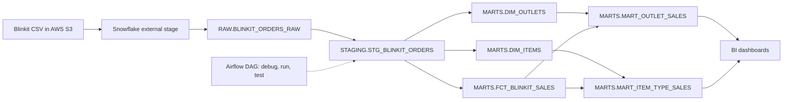

# Blinkit Retail Analytics Pipeline (Snowflake + dbt + Airflow)

An end-to-end ELT pipeline that loads Blinkit grocery sales data from AWS S3 into Snowflake, models it with dbt into staging, dimension, fact and mart layers, validates it with automated tests, and schedules it with Airflow.

## Architecture



## Models

| Layer | Model | Purpose |
| --- | --- | --- |
| Raw | `raw.blinkit_orders_raw` | CSV loaded as-is from S3 via `COPY INTO` |
| Staging | `stg_blinkit_orders` | Trims text, casts types, standardises 5 fat-content spellings into 2 categories |
| Dimension | `dim_outlets`, `dim_items` | One row per outlet / item |
| Fact | `fct_blinkit_sales` | Sales records with a generated surrogate key |
| Mart | `mart_outlet_sales` | Outlet-level sales, rating, visibility, outlet age |
| Mart | `mart_item_type_sales` | Sales and rating by item type and fat content |

## Data quality

- Generic tests: `unique`, `not_null`, `accepted_values`, `relationships` (fact to dimensions)
- Singular test: `tests/assert_no_negative_sales.sql`
- CI (GitHub Actions) validates that the dbt project compiles on every push

## Project structure

```
.
├── dbt_project.yml
├── profiles.yml.example        # env-var based, no secrets
├── .env.example
├── requirements.txt
├── Dockerfile
├── airflow/dags/blinkit_dbt_dag.py
├── macros/generate_schema_name.sql
├── models/
│   ├── staging/
│   └── marts/
├── tests/
├── scripts/run_pipeline.py
├── sql/bootstrap_snowflake.sql
└── .github/workflows/dbt_ci.yml
```

## Setup

1. Upload the Blinkit CSV to an S3 bucket (the CSV column order must match `sql/bootstrap_snowflake.sql`).
2. Create your local config:

```bash
python3 -m venv .venv && source .venv/bin/activate
pip install -r requirements.txt
cp .env.example .env      # fill in Snowflake + AWS values (git-ignored)
```

3. Run everything (Snowflake bootstrap, S3 load, `dbt build`, row-count checks):

```bash
python scripts/run_pipeline.py
```

Run dbt only (after raw data is loaded):

```bash
export $(grep -v '^#' .env | xargs)
cp profiles.yml.example profiles.yml
dbt build --profiles-dir .
dbt docs generate --profiles-dir . && dbt docs serve --profiles-dir .
```

Run in Docker:

```bash
docker build -t blinkit-dbt .
docker run --env-file .env blinkit-dbt
```

## Orchestration

`airflow/dags/blinkit_dbt_dag.py` defines a daily DAG: `dbt_debug >> dbt_run >> dbt_test`. Mount this repo at `/opt/airflow/dbt_project` in your Airflow environment and pass the Snowflake variables from `.env.example` as environment variables.

## Security

Credentials are never committed. `.env`, `profiles.yml`, `target/` and `logs/` are git-ignored, and AWS keys are injected into the bootstrap SQL in memory only.
